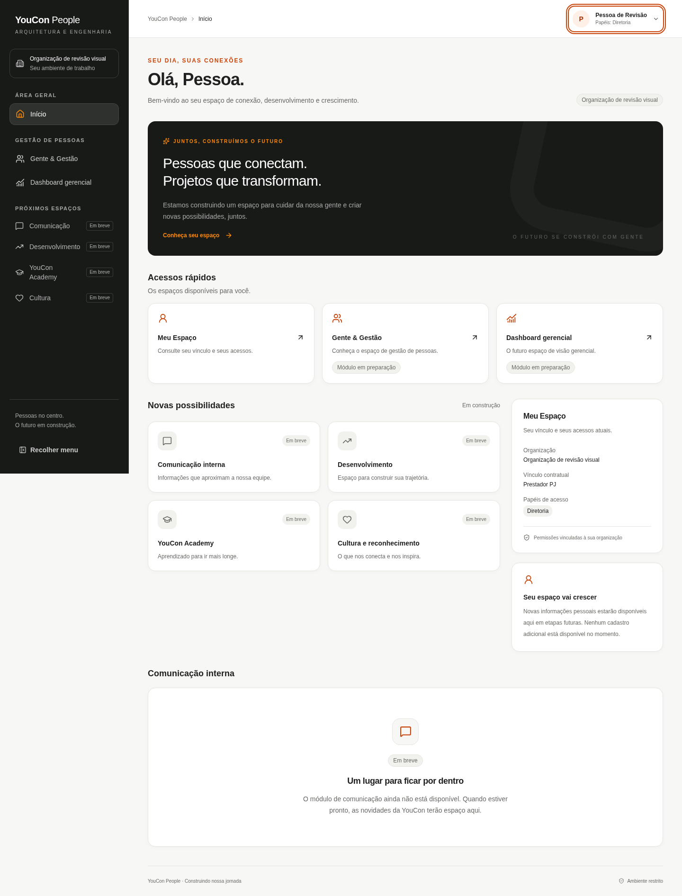
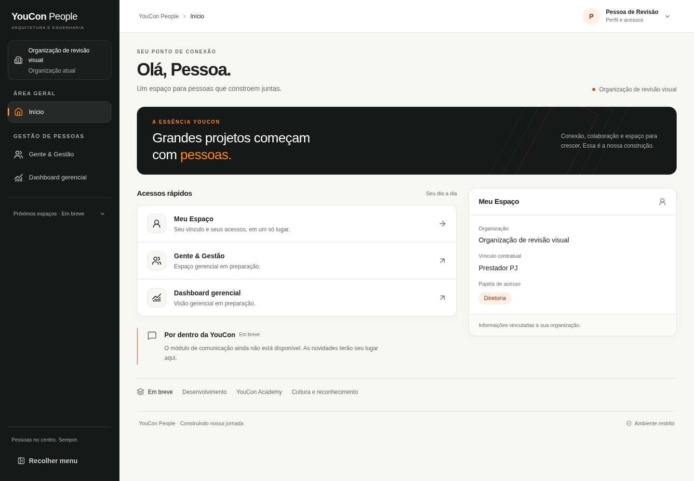
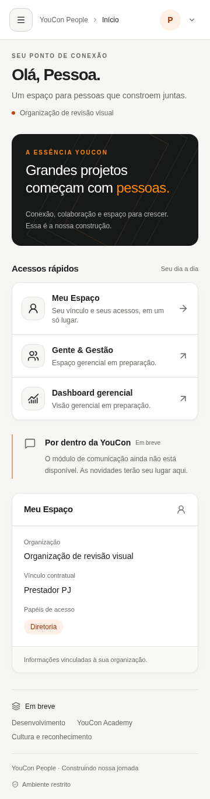

# Etapa 02.1 — redesign para revisão visual

Continuação da branch `feat/youcon-people-design-system` e do PR #2, sobre a entrega anterior `1da0291`. Implementação pronta para revisão; a aprovação visual pertence ao usuário. Sem merge ou publicação em produção.

## Mudança de composição

| Antes — Etapa 02 | Agora — Etapa 02.1 |
| --- | --- |
| Banner alto, com parágrafo e chamada | Faixa institucional curta, título expressivo, linhas arquitetônicas discretas |
| Três cards de acesso independentes | Acessos em linhas compactas com hover e seta de navegação |
| Quatro cards de módulos futuros | Faixa textual de três módulos; comunicação possui nota própria |
| Card pessoal e outro sobre evolução futura | Um único painel de vínculo e papéis |
| Grande card de comunicação | Nota com borda lateral e mensagem verdadeira |
| Sidebar de 272 px com futuros sempre expostos | Sidebar de 248 px, futuros recolhíveis, ativo com filete laranja |
| Modo recolhido de 88 px | Modo recolhido de 76 px, rótulos acessíveis e identidade preservada |
| Header de 80 px, papéis repetidos | Header de 68 px, nome ou conta neutra; detalhes no menu |
| Estado vazio grande e centralizado | Painel horizontal, transparente, tracejado e limitado a 760 px |

Home sintética gerencial, mesma sessão visual e viewport: altura da página em desktop 1440 px caiu de 1892 para 1000 px (viewport de 1000 px); no celular de 360 px caiu de 2953 para 1365 px. Essas medidas descrevem a fixture de revisão, não uma garantia para qualquer texto ou perfil.

## Comparação visual

Capturas com dados sintéticos, nunca dados pessoais do banco:

| Desktop — antes | Desktop — depois |
| --- | --- |
|  |  |

| Celular — antes | Celular — depois |
| --- | --- |
|  |  |

## Verificações

- Lint, typecheck, 48 testes em 7 arquivos e build Next.js 16.4.1 Webpack aprovados.
- Chromium: Home, Gente & Gestão e Dashboard em 360/390/768/1024/1440 px, sem overflow horizontal ou erros JavaScript.
- Sidebar recolhe/expande; drawer móvel abre/fecha com Escape e retorna foco; menu de conta fecha com Escape.
- Visibilidade gerencial preservada para RH/Diretoria e ausente para Profissional/Liderança; guardas reais no servidor permanecem intactas.
- Fallback “Profissional” verificado em Home e menu por teste de navegador; três casos automatizados cobrem nome genérico, variação com espaços e ausência. Vínculo PJ e papel Diretoria continuam identificados separadamente.
- Aplicação Next real, sem sessão: `/home`, `/gente-gestao` e `/gente-gestao/dashboard` redirecionam para `/login`.
- Preferência de movimento reduzido respeitada pelas regras de transição e transform; revisão humana de leitor de tela continua recomendada.

A revisão visual utiliza o harness isolado em `work/`, ignorado pelo Git, importando os componentes reais e substituindo consultas/ações apenas no bundle de revisão. Não há rota de bypass na aplicação. Os screenshots de antes foram preservados da revisão da entrega anterior.

## Banco, autenticação e limites

Nenhuma conexão ou alteração no Supabase compartilhado nesta rodada. Nenhuma migração remota, seed, reset, usuário, registro, configuração, Auth, RLS ou objeto alterado. SQL existente é executado somente em PGlite efêmero local pelo npm test. Clientes, Server Actions, proxy, política de permissões, guardas e arquivos SQL permanecem sem alterações. Não foi criado novo projeto nem planejada migração para outro banco.

Nome é lido de profiles.display_name; o fallback já existente “Profissional” foi tratado somente na apresentação. Sem nome confiável, a interface é neutra. Nenhum dado pessoal, indicador ou módulo operacional novo foi criado. Sem novas dependências.

## Pendências

Revisão visual pelo usuário na Preview protegida do PR #2. Login, renovação e logout autenticados não foram repetidos: não há sessão autorizada neste ambiente. Validar manualmente com contas existentes, sem criar registros. Identidade textual existente preservada; logomarca oficial permanece pendente. Não há regressão detectada nos cenários executados; isso não substitui a homologação autenticada.
