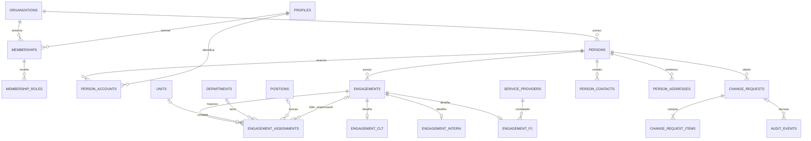
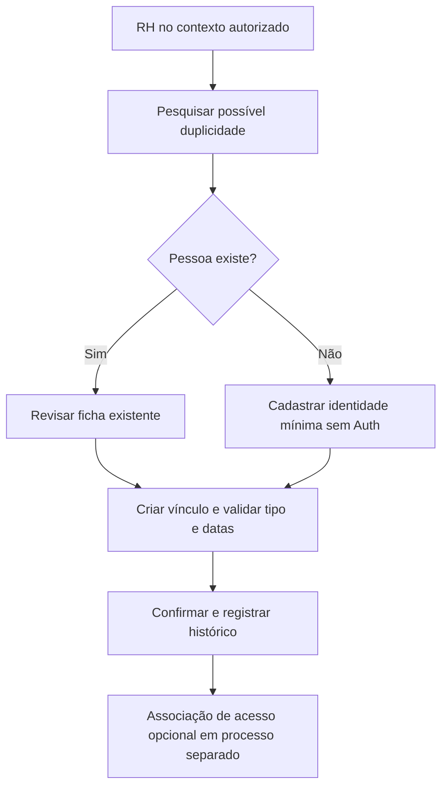
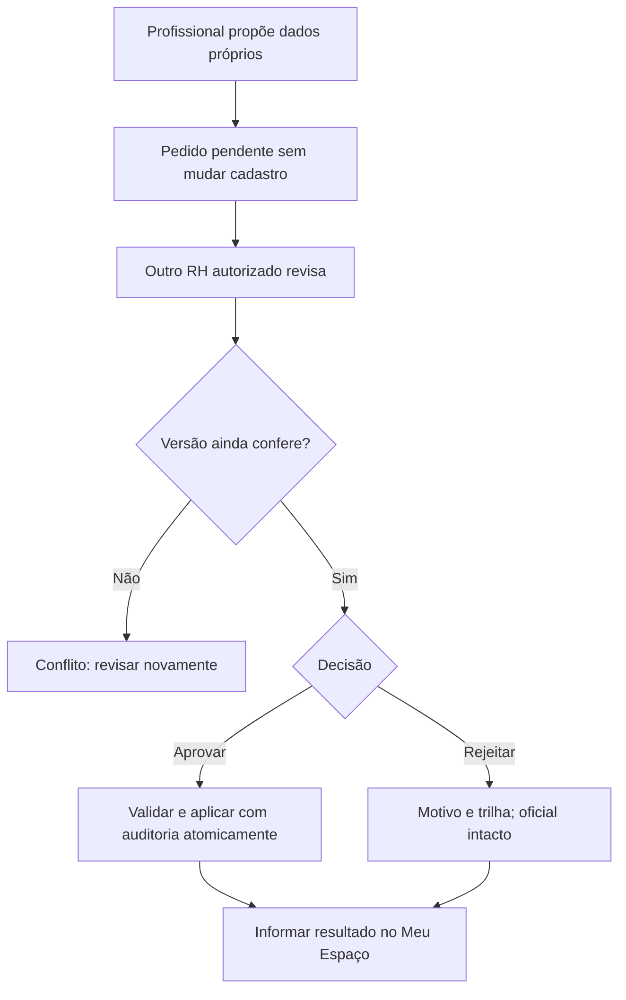

# YouCon People — Etapa 03A: Base Central de Pessoas

> Atualização: as decisões aprovadas para a interface estão consolidadas em [Etapa 03B — decisões](../stage-03b/DECISOES.md), que prevalece sobre propostas conflitantes deste registro da 03A. O banco permanece sem autorização de alteração.

Data: 13/11/2026. Estado: proposta para revisão, sem aprovação presumida.

## 1. Escopo e evidências

Entrega exclusivamente documental. Nenhum comando ou SQL foi enviado ao Supabase. Não foram alterados dados, Auth, Storage, RLS, funções, triggers, permissões, API ou configurações. Nenhum projeto criado, funcionalidade implementada, merge ou deploy realizado. O projeto compartilhado será mantido; não há plano de migração para outro banco. Ponto, férias, ausências e avaliação técnica externa ficam fora do escopo.

### Estado confirmado do GitHub

| Referência | Commit | Situação em 13/11/2026 |
| --- | --- | --- |
| main | 9e3edfdde5f2c3ea70ce855d26d32f5216d563af | Commit inicial; inadequada para iniciar esta etapa |
| feat/youcon-people-foundation | 19cae873a73e4b7978b1b6a777162808b5b9913f | PR #1 aberto, rascunho, sem merge, base main |
| feat/youcon-people-design-system | 7a260ed451148004c8c108edb5841db5d93bfbbb | PR #2 aberto, rascunho, sem merge, base foundation; Etapa 02.1 mais recente |
| docs/youcon-people-stage-03a | derivada de 7a260ed | Branch local exclusivamente documental |

PRs: https://github.com/ThiagoCardim/plataforma-RH/pull/1 e https://github.com/ThiagoCardim/plataforma-RH/pull/2.

A divergência foi informada no chat antes de elaborar a proposta. `merge-base(19cae87,7a260ed)=19cae87`: a versão visual inclui a fundação, sem necessidade de merge para analisar. Aprovação visual da Etapa 02.1 pendente. Versão mais recente do código não significa versão aprovada ou publicada. O estado de produção não foi consultado nesta rodada.

### Fontes inspecionadas na versão 7a260ed

- AGENTS.md; README.md; docs/ARCHITECTURE.md, SHARED_DATABASE.md, MIGRATION_APPLIED.md, CONTINUE.md, DESIGN_SYSTEM.md e STAGE_02_1_DELIVERY.md.
- src/modules/access/server.ts e policy.ts; src/lib/supabase/types.ts e options.ts; package.json.
- supabase/migrations/20261110203914_youcon_people_shared_database_foundation.sql, somente como texto. A documentação posterior confirma aplicação histórica; o comentário inicial de preparação no SQL é anterior a essa aplicação. Não reaplicar.

As constatações do banco são inferidas do código e dos registros técnicos existentes, não uma auditoria remota atual. Contagens reais, drift de schema, inventário completo de outros apps e configuração atual de Auth não foram verificados. Não foram consultados registros pessoais.

## 2. Diagnóstico atual

Aplicação Next.js 16.4.1/React 19.3.0, Node 24.x, Supabase JS 2.117.3 e SSR 0.12.7. Login por senha e cookies SSR, `getUser()` para validar identidade; contexto por organização e permissões consultadas no banco. Cookie `youcon-organization` seleciona contexto, nunca concede acesso. Falhas negam acesso. Cache de renderização não é cache global de sessão; respostas autenticadas são privadas/no-store.

| Objeto existente em youcon_people | Responsabilidade atual | Limitação para Base Central |
| --- | --- | --- |
| organizations | Organização, id, name, slug | Reutilizar identidade organizacional; não duplicar catálogo |
| profiles | user_id, display_name, created_at | Perfil mínimo de conta; não é pessoa cadastral; leitura própria |
| memberships | organization_id, user_id, contract_type, active | Exige conta; UNIQUE(organization_id,user_id); não representa trajetória contratual |
| roles | professional, leadership, hr, director | Papéis acumuláveis, distintos do tipo CLT/estágio/PJ |
| membership_roles | Papéis do acesso | FK composta membership_id/user_id; preservar |
| permissions | home.view, people.management.view, people.dashboard.view | Não existem capacidades de escrita ou aprovação |
| role_permissions | Concessões por papel | Permissões gerenciais limitadas a RH/Diretoria |

As sete tabelas possuem RLS no SQL versionado; authenticated tem SELECT, não escrita. Perfis de terceiros não se tornam legíveis porque o usuário é RH. `youcon_people_private.has_permission` é SECURITY INVOKER, search_path vazio, identidade auth.uid(), respeitando RLS. Guardas e navegação reservam Gente & Gestão e Dashboard a RH/Diretoria. Não existem ainda pessoas, unidades, setores, cargos, histórico contratual ou solicitações implementados.

### Dependências compartilhadas e limites

Auth e infraestrutura Supabase são compartilhados, assim como recursos, disponibilidade, limites e poderes administrativos. A documentação registra `public.profiles`, schema `private` e trigger em `auth.users` de outra aplicação. Não copiar, reutilizar ou alterar esses objetos. Nome, responsáveis e dependências completas dessa outra aplicação precisam de inventário dos seus responsáveis antes de qualquer intervenção futura.

People usa schemas próprios `youcon_people` e `youcon_people_private`, cookie/storage `youcon-people-auth` e logout local. Não há FK People → auth.users nem trigger de provisionamento People. UUID Auth é validado operacionalmente. Criar conta pode acionar o trigger legado; é operação separada e não decorrência automática de cadastrar pessoa. Não usar public.profiles nem metadados editáveis do usuário para autorização. Não substituir funções existentes nem conceder novas capacidades nesta etapa.

## 3. Arquitetura conceitual proposta

Recomenda-se extensão aditiva no namespace People, preservando o núcleo de acesso. Nomes abaixo são propostas, não tabelas criadas. Toda entidade de negócio pertence a uma organização; a mesma pessoa física em organizações distintas terá registros locais separados. Evita revelar sua existência entre organizações. A alternativa de identidade global com projeções por organização exige governança adicional e fica adiada.

| Entidade proposta | Responsabilidade e invariantes |
| --- | --- |
| persons | Identidade cadastral local; UUID estável, organization_id, código interno único por organização; independe de login e contrato |
| person_accounts | Associação opcional pessoa ↔ profiles.user_id; no máximo uma associação vigente por pessoa e por usuário em cada organização; histórico de associação; validação operacional da identidade Auth |
| engagements | Relação profissional/contratual; N por pessoa, organization_id, tipo, datas e encerramento; CLT, estágio e prestação PJ distintos |
| engagement_assignments | Versões efetivas de unidade, setor, cargo/função e liderança; intervalos sem sobreposição para a alocação principal |
| units, departments, positions | Catálogos organizacionais com código, nome e inativação; referências históricas preservadas |
| engagement_clt, engagement_intern, engagement_pj | Extensões 0..1 por vínculo; somente a extensão compatível com o tipo é válida |
| service_providers | Pessoa jurídica prestadora: CNPJ/razão social segregados; vínculo PJ referencia fornecedor e pessoa física responsável pela atuação |
| person_contacts, person_addresses | Contatos classificados e endereço condicional; segregação de dados privados |
| change_requests, change_request_items | Solicitações e valores propostos, nunca atualização imediata do cadastro oficial |
| audit_events | Trilha de operações, correções e decisões, com acesso restrito e retenção definida |

`memberships` permanece concessão de acesso à organização. Não renomear nem remover `contract_type` agora; seu significado legado e consumidores precisam de transição posterior aprovada. Não fazer dele a fonte de verdade dos múltiplos contratos. A ficha usará engagements; a Home hoje usa membership.contract_type: será necessária decisão futura sobre resumo do vínculo principal. Não permitir divergência silenciosa ou sincronização global por trigger.

Conta não equivale a papel, e papel não equivale a cargo ou contrato. Pessoa sem conta não recebe profile fictício. Diretor com papel RH pode aprovar por sua concessão RH explícita, nunca por ser diretor. Associação person_accounts não concede membership ou papéis automaticamente. Não adicionar FK para auth.users: preservar a estratégia de integração atual, com validação e reconciliação controladas.

### Cardinalidades e isolamento

Todas as referências entre entidades organizacionais devem carregar organization_id e ter consistência por chaves compostas `(organization_id,id)`. Isso inclui pessoa, solicitação, vínculo, unidade, setor, cargo e líder. UUID difícil de adivinhar não substitui autorização. Nenhuma consulta admite organization_id enviado pelo cliente sem validação do contexto autenticado.

O diagrama omite organization_id e relações de auditoria para legibilidade; a regra de escopo aplica-se a todas as entidades de negócio. PROFILES/MEMBERSHIPS/ORGANIZATIONS/MEMBERSHIP_ROLES já existem; as demais são conceituais.

### Alternativas relevantes

1. Expandir memberships para pessoa/contrato: menor número de entidades, mas quebra unicidade e acopla histórico ao login. Recomenda-se engagements separado.
2. Identidade global: facilita deduplicação corporativa, mas cria risco de vazamento e governança transversal. Recomenda-se pessoa por organização inicialmente.
3. Contrato com JSON genérico: flexível, porém fraco em validações e segregação de acesso. Recomenda-se núcleo comum e extensões tipadas; JSON só para diferenças auditadas com lista de campos permitidos.
4. Múltiplos vínculos simultâneos: suportar no modelo, bloquear conflitos por tipo/regra e exigir justificativa do RH; alternativa inicial mais simples é permitir só um vigente por pessoa/organização. Decisão pendente.
5. Liderança por vínculo vigente, recomendada, preserva referência profissional. Alternativa por equipe requer entidade de equipe e regras ainda não definidas. Para PJ usar responsável pela relação/contrato, evitando presumir subordinação empregatícia.

## 4. Dicionário e minimização

Ver [DICIONARIO.md](DICIONARIO.md): finalidade, tipo, obrigação, leitura, edição, aprovação, histórico e proteção por campo. Campo opcional não deve aparecer como obrigatório por conveniência. Não coletar saúde, biometria, religião, raça, sindicato, documentos digitalizados, dados bancários, dependentes ou avaliação técnica nesta base inicial. CPF é dado pessoal de proteção elevada, não automaticamente dado sensível na definição legal. Dados sensíveis legais exigiriam finalidade, base legal e desenho próprios, fora desta entrega.

RH e jurídico/encarregado devem validar finalidade, base legal por processo, transparência, prazos de retenção e atendimento aos titulares. Consentimento não será presumido como base geral de relações profissionais. Não manter todos os dados para sempre sob pretexto de auditoria.

## 5. Matriz de permissões proposta

Tudo abaixo é capacidade futura, não concessão vigente. Papéis atuais são preservados. Todos os acessos exigem membership ativo na organização; autorização no servidor e banco, escopo de linha e projeção de campos. RH tem escopo somente das organizações explicitamente atribuídas.

| Operação | Profissional | Liderança | RH | Diretoria |
| --- | --- | --- | --- | --- |
| Consultar Base Central/listagem | Não | Não | Sim, org. atribuída | Sim, projeção gerencial da org. |
| Consultar próprios dados no Meu Espaço | Futuro, campos permitidos | Futuro, próprios | Futuro, próprios | Futuro, próprios |
| Criar pessoa sem acesso | Não | Não | Sim | Não por padrão |
| Editar cadastro oficial | Não | Não | Sim, com motivo | Não por padrão |
| Criar/movimentar/encerrar vínculo | Não | Não | Sim | Não por padrão |
| Ver histórico | Próprio, recorte futuro | Próprio, recorte futuro | Sim, escopo cadastral | Somente profissional/gerencial |
| Solicitar alteração própria | Futuro | Futuro | Futuro, sem autoaprovação | Futuro, sem autoaprovação |
| Aprovar/rejeitar solicitações | Não | Não | Sim, outro aprovador se próprio | Não; somente se receber papel RH |
| Consultar contato privado/documento | Próprio, mascaramento | Próprio, mascaramento | Somente necessidade funcional explícita | Não por padrão |
| Consultar sensíveis legais | Fora do escopo | Fora do escopo | Fora do escopo | Fora do escopo |
| Exportar | Não | Não | Capacidade adicional, recorte aprovado | Capacidade adicional, resumo gerencial |
| Vincular conta/provisionar acesso | Não | Não | Solicita validação operacional | Não por padrão |
| Atribuir papéis | Não | Não | Não nesta Base | Não nesta Base |

Liderança não tem acesso à Base completa, inclusive por URL direta, APIs, totais, filtros, autocompletar ou exportação. Uma futura visão de equipe será outro módulo com recorte próprio. Ter cargo de liderança não concede papel leadership. Pessoas encerradas continuam consultáveis por RH autorizado, sem manter acesso próprio automaticamente.

Capacidades sugeridas: people.person.create/update, people.engagement.manage/close, people.history.view, people.request.submit/review, people.private.view e people.export. Nomes finais, grants e policies serão objeto de proposta técnica posterior. As três permissões atuais não autorizam nenhuma escrita. `people.management.view` é condição de entrada da Base, não autorização irrestrita a todas as colunas. Dashboard mantém people.dashboard.view. Exportação não decorre de consulta. Projeções privadas devem ser segregadas: RLS filtra linhas, não garante proteção de colunas por si só.

## 6. Regras de negócio e fluxos

1. **Cadastro sem login:** RH seleciona organização autorizada, preenche mínimo cadastral, consulta possíveis duplicidades na mesma organização e confirma. Gera pessoa e código; pode cadastrar vínculo em etapa distinta. Nenhuma chamada de criação Auth, perfil ou papel. Cadastro parcial usa rascunho explícito; não fingir contrato ativo.
2. **Associação posterior de conta:** operador valida UUID Auth e identidade por procedimento confiável; e-mail sozinho não basta. Verifica unicidade e organização, registra associação e evidência sem segredos. Conta inexistente exige processo separado aprovado, por impacto no trigger legado. Associação não concede permissões. Desassociação preserva autoria histórica.
3. **Novo vínculo:** pessoa existente, tipo imutável após ativação, datas válidas e detalhe compatível. CLT não vira PJ por edição de enum: encerra relação anterior e cria outra. Permitir simultaneidade apenas se decisão aprovada e validação de conflitos.
4. **Cargo, setor, unidade e liderança:** criar nova versão de alocação com vigência e motivo; fechar período anterior na mesma transação futura. Datas no padrão [início,fim), fim exclusivo. Não alterar a versão antiga como se sempre tivesse sido assim. Cargo/unidade podem estar pendentes em rascunho; para ativar exigir os definidos na política aprovada.
5. **Liderança:** referência ao vínculo do responsável na mesma organização e vigente no período relevante. Impedir autorreferência e ciclos; ausência legítima é explícita. Encerrar líder exige tratar sucessão ou intervalo sem responsável. Para PJ é responsável contratual/operacional, sem assumir relação CLT.
6. **Encerramento:** RH informa data, motivo categorizado e confirmação de impacto. Preserva contrato, alocações e pessoa. Fim contratual é data inclusiva de negócio; períodos de alocação usam fim exclusivo documentado. Não excluir Auth, revogar sessão global ou afetar outro app. Planejar revogação People quando não houver outro vínculo elegível ou justificativa de acesso; execução depende de mecanismo e autorização futuros. Encerramento agendado precisa de aplicação temporal efetiva, não apenas badge no navegador.
7. **Reingresso:** mesma pessoa, novo engagement e novas datas; não reabrir contrato encerrado, não recriar permissões automaticamente. RH revisa associação e acesso separadamente.
8. **Correção cadastral:** distinguir correção de erro e movimentação real. Correção informa razão, valor anterior, autor e instante. Retificação retroativa mantém a versão original e registra a substituição/correção. Não apagar evidência necessária; não duplicar PII integral sem necessidade.
9. **Pedido próprio:** Meu Espaço futuro apresenta campos permitidos; usuário propõe alteração e vê “em análise”. Cadastro oficial não muda. Não permitir solicitar papel, organização, tipo de contrato ou salário por edição cadastral livre. Liderança segue a mesma regra para seus próprios dados.
10. **Revisão RH:** fila na organização, compara proposta com versão original e atual. Aprovação revalida permissão, campos e versão, aplica alteração e registra decisão atomicamente. Rejeição exige motivo e não altera oficial. RH não aprova solicitação própria; encaminha a outro RH autorizado. Diretoria não substitui RH aprovador por padrão. Se não houver outro RH, fica pendente para decisão de governança, sem bypass.
11. **Concorrência:** versionamento otimista por pessoa/vínculo. Divergência retorna conflito e exige nova revisão; repetir clique usa chave de idempotência. Solicitação já decidida não pode ser aplicada de novo. Recomenda-se aprovação integral por pedido inicialmente; aprovação parcial exige fluxo adicional explícito.
12. **Duplicidades:** nome/e-mail são indícios, não chave de pessoa. CPF validado pode reforçar alerta quando coletado legitimamente; não pesquisar globalmente entre organizações. RH revisa manualmente. Fusão futura com segundo revisor, mapa de referências, identificação canônica e trilha reversível; sem exclusão automática, sem fusão Auth ou objetos de outro app.
13. **Isolamento:** troca de organização revalida membership e papel; todas as entidades, contagens e exportações usam o mesmo escopo. Relações cruzadas são recusadas inclusive com IDs válidos. Pessoa física em duas organizações não revela a ficha da outra.
14. **Catálogos:** inativar unidade/setor/cargo sem apagar uso histórico; proibir novas alocações após inativação. Renomeações relevantes mantêm versão ou rótulo histórico. Exclusão física de pessoa/contrato não é operação comum da Base.
15. **Status:** pessoa não tem um único “empregado ativo” global. Exibir “com vínculo vigente”, “sem vínculo vigente” ou “cadastro em preparação”, derivados das relações e data de referência. Vínculo distingue rascunho, programado, vigente, encerrado e cancelado antes do início; transições e datas consistentes, sem misturar férias/ausências.

## 7. Proposta de experiência

Planejamento sem telas implementadas. Seguir tokens e componentes locais, composição compacta da Etapa 02.1: sidebar 248/76 px e header 68 px, substituindo medidas antigas ainda citadas em trechos da documentação visual. Fundo neutro, texto escuro, laranja como ação/foco, divisórias sutis, ícones Lucide, tipografia local e movimento reduzido. Sem gráficos decorativos, dados fictícios de produção ou logomarca nova.

| Tela futura | Conteúdo e comportamento |
| --- | --- |
| Listagem de Pessoas | Contexto de organização visível; busca por nome/código, filtros de vínculo/status/setor/cargo/unidade; tabela paginada no servidor. Uma linha por pessoa, resumo de múltiplos vínculos sem duplicar contagem. Sem CPF, telefone privado ou e-mail pessoal em listagem gerencial. Filtros não revelam outra organização. RH vê “Cadastrar pessoa”; Diretoria consulta |
| Ficha | Cabeçalho com nome/código e status profissional separado de acesso. Abas Resumo, Cadastro, Vínculos, Histórico; situação de conta apenas mínima. Se vários vínculos, lista e seleção explícitas, sem supor um único atual. Dados privados em seção restrita; nunca no HTML enviado a quem não pode ver |
| Cadastro | Seções Identificação, Contato, Vínculo, Alocação, Revisão; permitir salvar pessoa sem vínculo/conta. Campos condicionais CLT/estágio/PJ. Obrigatoriedade explicada; validação por campo e resumo com foco. Combobox existente aceita texto livre: servidor deve confirmar ID de catálogo. Cancelamento com aviso de alterações não salvas |
| Movimentações | Selecionar vínculo, tipo, nova alocação, vigência e motivo; comparar antes/depois e indicar conflitos. Linha do tempo separa data efetiva e data de registro. Encerramento tem confirmação contextual e impacto de acesso |
| Solicitações | Meu Espaço futuro mostra dados atuais, proposta e estado; RH vê fila com comparação e versão, aprovação/rejeição e justificativa. Diretoria não recebe botões de decisão por seu papel |

Estados obrigatórios em cada tela: carregando, vazio real, busca sem resultado, erro com nova tentativa, acesso negado, conflito de versão e sucesso anunciado. Operações não devem parecer concluídas antes da confirmação. Navegação por teclado, labels, fieldset, caption de tabela, foco após erro/diálogo, mensagens sem depender só de cor e adaptação móvel. Endereços e documentos fora de URL, logs, telemetria e notificações. Não prometer autosave oficial no fluxo de solicitação.

## 8. Histórico, auditoria e privacidade

Dois tempos: vigência de negócio (date) e registro da operação (timestamptz UTC, apresentação America/Sao_Paulo). Para reconstruir “o que se sabia naquela data”, manter versões/supersessões de correções, não somente updated_at. Alterações de alocação e contrato têm origem, autor, motivo e referência da solicitação quando houver.

Auditoria futura registra organization_id, ator Auth UUID, papel/capacidade efetiva, entidade/id, ação, correlação/idempotência, instante, vigência e diferença mínima de campos. Associação encerrada ou conta removida não apaga autoria: conservar identificador e evidência operacional mínima. Não registrar senha, JWT, chaves ou payload irrestrito. Documento completo não vai para auditoria genérica; mascaramento ou referência a versão protegida. Leitura de dados privados e exportações também são eventos auditáveis.

A aplicação não oferece edição/exclusão de audit_events; política de escrita futura deve impedir adulteração por usuários comuns. Isso não torna o banco imutável contra administradores compartilhados. RH vê histórico cadastral; Diretoria, recorte profissional; trilha técnica completa fica com responsáveis autorizados.

Definir tabela de retenção por categoria e fundamento com RH/jurídico: cadastro, contrato, pedido, auditoria, exportação e backup. Após obrigação/prazo, eliminar ou anonimizar de forma controlada; retenção legal suspende descarte. Registrar acesso a titulares, retificação e decisão sobre eliminação. Exportação com colunas mínimas, finalidade, responsável, expiração e trilha; CSV deve neutralizar fórmulas. Sem anexos/Storage nesta primeira proposta.

## 9. Integrações futuras

| Módulo | Referência e gatilho de negócio propostos | Elegibilidade e limite |
| --- | --- | --- |
| Onboarding | person_id + engagement_id; início programado | Checklist por CLT/estágio/PJ; cadastro não cria conta automaticamente |
| Offboarding | Encerramento do engagement | Verificar outros vínculos e acesso People; nunca exclusão Auth global automática |
| Desenvolvimento | Pessoa e contexto profissional vigente | Referenciar plataforma externa de avaliação; não copiar notas/avaliação técnica |
| Cultura/reconhecimento | Participação por vínculo/org. e finalidade | Regras PJ específicas; não presumir mesmos benefícios |
| Carreira | Histórico de posições e movimentações | Trilhas CLT/estágio; PJ segue evolução de escopo contratual, sem equivalência automática |
| Pesquisas | Público elegível no instante de referência | Separar respostas e identidade; anonimato não pode ser desfeito pela Base |
| Comunicação | Contato profissional e segmentos autorizados | Excluir encerrados conforme regra; contato pessoal só com finalidade legitimada |
| Dashboard | Métricas por organização e data efetiva | Distinguir pessoas únicas e vínculos, separar CLT/estágio/PJ, reduzir risco em grupos pequenos |

Contratos de integração deverão usar IDs estáveis e eventos versionados pós-confirmação, com deduplicação e mínimo de PII. Não criar triggers, filas, webhooks ou sincronização agora. Cada consumidor revalida escopo e elegibilidade; não recebe tabela inteira como integração padrão.

## 10. Riscos do Supabase compartilhado

| Risco | Impacto | Tratamento proposto antes de qualquer execução futura |
| --- | --- | --- |
| Reaplicar fundação ou SQL arquivado | Colisão e indisponibilidade | Nunca executar; nova proposta incremental específica, revisar histórico |
| Criar/excluir Auth ou alterar configuração | Trigger legado, sessões e outro app | Processo separado; preferir associação de identidade existente validada |
| Policy permissiva por organização | Profissional/líder acessa Base | Capacidade gerencial + escopo + colunas; testes negativos por API |
| Usar profiles/memberships como cadastro | Perda de históricos e exclusão de pessoas sem login | Separação conceitual recomendada, sem alterar núcleo nesta etapa |
| FK apenas por UUID | Referências entre organizações | Chaves/validações compostas em proposta futura |
| Grant herdado, função privilegiada ou service_role | Bypass e exposição | Inventariar ACL/defaults; revisão de cada objeto; sem chave privilegiada no browser |
| Listas/exportações/logs com PII | Vazamento e descumprimento de finalidade | Projeções restritas, minimização, auditoria e retenção |
| DDL/índice ou consulta pesada | Locks, saturação compartilhada | Orçamento de consultas, índices por escopo, paginação e limites; timeouts locais em plano futuro |
| Fim de contrato sem revogação People | Acesso indevido posterior | Definir regra temporal e execução futura verificável, sem atingir outro app |
| Auditoria insuficiente ou eterna | Fraude ou coleta excessiva | Versões, ator, revisão, retenção por finalidade |
| Drift entre código e remoto | Plano incompatível com produção | Inventário somente leitura autorizado antes de preparar SQL final |
| Recuperação global inadequada | Restaurações afetam outros apps | Recuperação coordenada e granular; não tratar restore global como rollback simples |

Schemas não isolam administradores nem capacidade de infraestrutura. A documentação histórica de migração não certifica ausência de alterações posteriores. Não corrigir avisos ou índices de outros apps. Nenhuma inspeção remota SQL ou teste com escrita foi necessário nesta rodada.

## 11. Plano incremental da Etapa 03B

Aprovação deste documento não autoriza implicitamente escrita remota, deploy, novo Supabase ou merge.

1. **Fechar decisões:** validar arquitetura, campos, matriz, simultaneidade e retenção; resolver revisão visual 02.1 e confirmar SHA base. Se PRs avançarem, reavaliar diferenças sem fazer merge automático.
2. **Inventário técnico de leitura:** confirmar com responsáveis schema/ACLs/consumidores e limitações do projeto compartilhado; sem coletar PII. Entregar mapa de objetos e diferenças em relação ao contrato versionado.
3. **Especificação executável para revisão:** desenhar constraints, índices, autorização por linha/coluna, transações e plano de revogação. Produzir SQL como proposta documental com objetos afetados, impacto, lock budget e recuperação granular. Não executar.
4. **Verificação local isolada:** após autorização de desenvolvimento, usar PGlite/Postgres local efêmero e dados sintéticos; isso não cria outro projeto Supabase nem muda a decisão do banco compartilhado. Validar CLT/estágio/PJ, sem conta, reingresso, simultaneidade, vigência, concorrência, aprovação e isolamento. Não apontar testes gravadores ao projeto ativo.
5. **Primeiro incremento funcional:** após escopo aprovado, cadastro mínimo e consulta RH/Diretoria, antes de automações. Depois vínculos/alocações/histórico; depois fila de solicitações; Meu Espaço em incremento explicitamente autorizado. Exposição remota depende da aprovação técnica específica, não só da existência de telas.
6. **Revisão de segurança e experiência:** teste ponta a ponta local, acesso direto à API, quatro papéis, duas organizações sintéticas, campos privados, revogação e dupla submissão. Preservar guardas/cookies e comportamento dos outros apps. Nenhuma fixture no banco ativo.
7. **Eventual aplicação remota:** somente após revisão de SQL exato, dependências, recuperação, janela e autorização específica do usuário. Aplicar apenas mudanças aprovadas no namespace People; não usar reset/db push global. Produção/merge são decisões separadas.

Critérios mínimos: pessoa sem login funciona; mesma pessoa mantém múltiplos vínculos históricos; PJ tem vocabulário próprio; líder não lê Base por nenhum caminho; diretor não aprova sem RH; pedido pendente não altera oficial; correção preserva rastreabilidade; nenhum ID de outra organização é aceito; encerramento não muda Auth de outro app. Relatório futuro deve distinguir testes locais, leitura remota e eventual escrita autorizada.

## 12. Decisões para aprovação

| ID | Decisão | Recomendação / alternativa |
| --- | --- | --- |
| D01 | Base técnica e revisão visual | 7a260ed/Etapa 02.1 como referência; aprovação visual continua separada |
| D02 | Pessoa por organização ou global | Local à organização inicialmente; global só com governança transversal |
| D03 | Separar acesso e contratos | Preservar memberships; criar conceito engagements separado |
| D04 | Contratos simultâneos e principal | Modelo suporta; RH valida exceções e vínculo principal explícito. Alternativa: bloquear simultaneidade inicialmente |
| D05 | Operações Diretoria | Consulta gerencial; sem escrita/aprovação automática. Alternativa: capacidades pontuais aprovadas |
| D06 | Campos obrigatórios e privados | Mínimo nome/código/org.; CPF/endereço/detalhes só por necessidade validada |
| D07 | Aprovação e conflito de interesse | Outro RH para pedido próprio, aprovação integral inicialmente; alternativa parcial exige desenho adicional |
| D08 | Vínculo da liderança | Referenciar vínculo e vigência; equipes em evolução posterior; responsável contratual para PJ |
| D09 | Elegibilidade de acesso e encerramento | Definir se todo acesso exige contrato vigente ou admite exceção administrativa documentada |
| D10 | Associação Auth | Validação por operador, sem criar conta automaticamente; definir responsáveis e evidência mínima |
| D11 | Retenção e base legal | RH/jurídico aprovam prazos e fundamentos antes da coleta adicional |
| D12 | Exportação e dados privados | Capacidade explícita e finalidade; Diretoria recebe resumo, sem documentos/contato privado |
| D13 | Duplicidades | Revisão manual e fusão controlada futura, sem automática |
| D14 | Transição contract_type legado | Escolher contrato principal/representação na Home; não alterar núcleo de acesso por consequência do cadastro |
| D15 | Recorte da 03B | Começar pessoa + consulta/cadastro; priorizar contratos/histórico, depois solicitações e Meu Espaço |

É possível aprovar por ID ou solicitar revisão. Nenhuma proposta acima substitui autorização específica para banco, permissões ou produção. Após decisões, iniciar 03B pelo inventário e desenho técnico revisável, mantendo o Supabase compartilhado e todas as restrições até autorização posterior.
