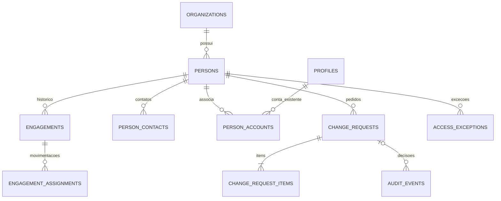

# Etapa 03C.1 — persistência: proposta técnica para revisão

> Continuidade: os corpos completos, correções e testes PostgreSQL locais estão em [especificação final](../stage-03c-final/README.md). Este documento e seu SQL preliminar permanecem históricos; não aplicar os dois pacotes.

13/11/2026. Somente documentação. Base: 6adeaa6, interface aprovada da 03B; PR #3 aberta em rascunho, sem merge. Nova branch docs/youcon-people-stage-03c-1. D01–D15 de ../stage-03b/DECISOES.md permanecem vinculantes. Nenhum código de aplicação, autenticação, permissão ou demonstração foi modificado. O SQL acompanha este documento em arquivo .sql.txt, fora de migrations e sem execução automática. Não é pacote pronto para implantação: gates procedurais abaixo são obrigatórios.

## Diagnóstico e inventário de leitura

Foi possível consultar exclusivamente pg_catalog e pg_policies do projeto compartilhado autorizado, sem ler linhas de pessoas, organizações, contas, contatos ou contratos. A primeira chamada com três SELECT retornou somente o último resultado (constraints); a segunda agregou os metadados numa resposta única. Evidências brutas, sem registros pessoais, estão em INVENTARIO.txt.

Confirmados: organizations, profiles, memberships, roles, permissions, role_permissions, membership_roles no schema youcon_people. Todas têm RLS; authenticated possui somente SELECT; service_role mantém privilégios administrativos existentes. Constraints observadas correspondem às definições versionadas: memberships exige profile e organização, unique(organization_id,user_id), unique(id,user_id); membership_roles referencia o par membership_id/user_id. Não há tabelas cadastrais de pessoas no inventário.

As sete policies são SELECT: memberships próprios ativos, profiles próprio, organizations de membership ativo, atribuições próprias ativas e catálogos acessíveis a membro ativo. RH/Diretoria não ganham leitura de profiles de terceiros por consequência de seu papel. Em youcon_people_private, has_permission é SECURITY INVOKER, search_path vazio e execução por authenticated, coerente com a fundação. Nenhum trigger não interno People foi encontrado. Auth contém o trigger on_auth_user_created_link_profile, associado a link_profile_on_auth_user: dependência compartilhada preservada, não inspecionada quanto ao corpo para evitar exposição desnecessária de objetos alheios.

Não detectada divergência nas constraints e policies conferidas. Isso não certifica equivalência integral: colunas, índices, defaults, grants de schema/funções adicionais, versão interna de has_permission, exposição API e cadeia completa de dependências ainda exigem preflight direcionado antes de executar qualquer proposta. Não afirmar ausência de drift nesses itens. O comentário histórico “not applied” da migração é anterior ao registro de aplicação; nunca reaplicar a fundação. Não criar outro projeto nem alterar public/private/auth/storage.

## Modelo e dicionário técnico

O SQL documental define tipos, nulabilidade, PKs/FKs/checks/índices das novas entidades. Identificadores uuid, datas de negócio date, instantes timestamptz UTC; apresentação America/Sao_Paulo. Todas as entidades têm organization_id NOT NULL, id, created_at e created_by; unique(organization_id,id) suporta FKs compostas. FKs de negócio são sempre compostas para impedir referências cruzadas. Nenhum FK novo para auth.users. Não duplicar organizations/profiles/memberships ou os catálogos de acesso.

| Entidade nova | Responsabilidade e campos principais |
| --- | --- |
| persons | internal_code único por organização, full_name obrigatório, display_name opcional, version para concorrência |
| person_contacts | Pessoa, kind email/phone, scope professional/private, value, is_primary; contato opcional, sem alterar login |
| engagements | Pessoa, contract_type clt/intern/pj, start_date/end_date inclusivos, state draft/confirmed/cancelled, version |
| units/departments/positions | Código único na organização, nome e active; inativação preserva referência histórica |
| engagement_assignments | Vínculo, unidade/setor/cargo obrigatórios na ativação, líder opcional como vínculo da mesma organização, valid_from/valid_to exclusivo, reason, supersedes_id |
| engagement_clt | Detalhe 0..1 por vínculo: modalidade e matrícula opcionais na entrada |
| engagement_intern | Instituição/curso/termo e supervisor, complementação posterior |
| service_providers/engagement_pj | Empresa contratada e escopo, referência contratual; identificador fiscal texto, compatível com evolução alfanumérica; não coletado no mínimo inicial |
| person_accounts | Pessoa ↔ profile.user_id existente, validade; associação vigente única em ambos os sentidos por organização |
| change_requests/items | Solicitante derivado da sessão, condição RH atestada pelo servidor, versão-base, itens de lista permitida, revisor/motivo/instante e estados explícitos |
| access_exceptions | Pessoa/usuário, período finito, motivo, aprovador distinto, revogação; nunca cria papel |
| audit_events | Ator/capacidade, entidade, ação, tempos efetivo/registro, correlação, pedido e diferença mínima protegida |

Não coletar CPF, nascimento, endereço, banco, remuneração, saúde, biometria ou anexos na primeira persistência. Contatos privados são opcionais e sua coleta fica desabilitada até finalidade e capacidade específicas aprovadas. Diretoria edita identificação e dados profissionais, não recebe automaticamente acesso a dados privados. Edição de campo privado exige people.private.update além de autorização cadastral. O campo protected_diff não pode receber payload arbitrário ou segredos; sua escrita é exclusivamente do servidor com esquema de campos permitidos.

## Invariantes transacionais obrigatórios (gate antes de grants)

Apenas índices parciais não garantem não sobreposição de intervalos datados. Não usar CURRENT_DATE em predicado de índice nem boolean active como fonte isolada. Para evitar instalar btree_gist no projeto compartilhado, escolher inicialmente serialização por lock da linha persons, sempre obtido antes de criar/alterar/encerrar qualquer vínculo. Ordenar locks por UUID em operações múltiplas. Dentro da mesma transação, recusar interseção entre contratos confirmed da mesma pessoa/organização: início A <= fim B e início B <= fim A, com NULL representando infinito. Isso inclui contratos programados. Mudanças futuras e reingresso não podem introduzir sobreposição; fim inclusivo exige próximo início posterior ao fim. Rascunhos/cancelados não concedem elegibilidade. Futuramente uma exclusion constraint só pode ser escolhida após inspeção/autorização da extensão, nunca instalação implícita.

A implementação futura deverá criar triggers de integridade somente nas novas tabelas para obrigar o lock e validar a regra mesmo em escrita administrativa acidental. A criação dessas funções/triggers ainda não está incluída como DDL final no anexo: seu contrato abaixo é requisito de revisão e teste, não validação já implementada. Antes de liberar escrita, produzir seus corpos SQL completos e revisá-los; sem eles a etapa estrutural permanece sem grants de aplicação.

- guard_engagement_period: lock de persons, comparar todos os contratos confirmados exceto o próprio; rejeitar sobreposição e inconsistência de tipo/extensão. Tipo confirmado não é editável; mudança CLT→PJ encerra e cria novo vínculo.
- guard_assignment_period: lock do engagement; intervalos [início,fim) não sobrepostos e dentro do contrato; proibir auto-liderança, ciclos e líder fora da vigência. Exigir catálogos ativos na nova alocação. supersedes_id deve ser FK composta autorreferente e apenas apontar versão do mesmo vínculo; adicionar essa constraint na especificação final.
- guard_contract_detail: impedir detalhe CLT em vínculo PJ/estágio e vice-versa, inclusive quando o pai for alterado. Completar dados contratuais é operação específica, sem transformar cadastro mínimo em formulário extenso.
- guard_account_assignment: lock da pessoa e da membership existente; identidade validada pelo operador; impedir vínculo com membership de outra organização e períodos de associação sobrepostos por usuário e por pessoa, inclusive associações encerradas. UUID/e-mail não bastam como prova de identidade.
- guard_request_decision: bloquear linha do pedido e versão da pessoa; ator auth.uid() obrigatório e distinto do solicitante; status pending único elegível; atestar condição RH no envio e confirmar novamente para revisão excepcional; aplicar itens permitidos e registrar decisão/auditoria numa única transação.
- reject_history_mutation: UPDATE/DELETE de eventos auditáveis negados a operações comuns; correções são eventos de retificação, nunca remoção da evidência original.

Para cadastro, edição e movimentações, funções transacionais futuras receberão organization_id, expected_version e idempotency_key. A tabela futura operation_receipts deverá ter PK(organization_id,actor_user_id,idempotency_key), hash do comando e resultado mínimo; repetir mesma chave com comando diferente falha. Lock e retorno anterior evitam duplicação por retry. Seu DDL é parte do gate procedimental, não do lote estrutural anexado. Campos de autoria, papéis e status não são aceitos do cliente.

## Matriz de autorização e RLS proposta

| Operação/capacidade | Profissional/Liderança | RH | Diretoria |
| --- | --- | --- | --- |
| Base / management.view | Negado | Organização atribuída | Organização atribuída |
| person.create/update / engagement.manage | Negado | Sim | Sim |
| history.view | Sem Base; próprio recorte em fase posterior | Sim | Projeção profissional |
| private.view/update | Próprio via API específica futura | Só concessão específica e finalidade | Só concessão específica, sem automática |
| request.submit | Apenas próprios campos permitidos, via Meu Espaço futuro | Próprio pedido | Próprio pedido |
| request.review | Negado | Pedido alheio | Somente pedido próprio de profissional RH; ator distinto |
| export.management | Negado | Capacidade explícita | Capacidade explícita, somente gerencial |
| engagement.close | Negado | Capacidade específica | Capacidade específica |
| accounts.link / exception.manage | Negado | Processo operacional autorizado | Processo operacional autorizado, sem autoexceção |
| audit.full | Negado | Não automático | Não automático; auditor autorizado específico |

Propostas de capacidades adicionais não equivalem a grants executados. Manter os quatro papéis existentes; ampliar o catálogo apenas com autorização futura. Nenhuma policy genérica de membro da organização nas tabelas gerenciais. RLS de leitura básica usa has_permission(org,'people.management.view') em cada tabela. O SQL exemplifica policies básicas, porém deliberadamente NÃO concede SELECT nem escrita ainda. Antes da exposição efetiva, elas também deverão exigir elegibilidade People descrita abaixo. Contatos/contratos detalhados/pedidos/auditoria ficam sem leitura direta; endpoints/projeções entregam campos autorizados. RLS não protege colunas: não misturar dados privados na tabela básica nem publicar protected_diff em uma view gerencial. Projeção de exportação: código interno, nome de exibição, setor, cargo/função, unidade, tipo, situação e datas; exclui e-mail privado, documento, motivo privado e metadados de conta. CSV deve neutralizar fórmulas e ter limites/rastreabilidade.

Escritas diretas authenticated permanecem negadas. Preferir RPCs específicas, sem SQL dinâmico ou parâmetros de campo arbitrários. Funções SECURITY DEFINER, se necessárias para escrita atômica e leituras de aprovação, precisam de revisão própria: owner dedicado NOLOGIN/NOBYPASSRLS com privilégios apenas People e escopo mínimo, search_path vazio, nomes qualificados, REVOKE EXECUTE de PUBLIC/anon, checagem explícita de auth.uid(), membership e capacidade por organização. A criação do owner é mudança de role no projeto compartilhado e exige autorização específica; não está no lote inicial. Não adotar implicitamente postgres/service_role como identidade de execução. Validar ausência de recursão entre RLS e função auxiliar; preservar has_permission atual até a etapa de revogação revisada.

## Revogação People sem afetar Auth compartilhado

Acrescentar política de elegibilidade People a TODAS as operações People, guardas de rota e policies dos objetos atuais, não apenas à nova Base. Após associação validada, membership ativo só concede acesso quando existe contrato confirmado vigente ou exceção aprovada vigente. Encerramento imediato atualiza membership.active=false na mesma transação, salvo exceção ativa. Encerramento futuro exige checagem temporal no banco em cada operação, pois um job pode atrasar. Ao expirar exceção, a mesma checagem temporal nega acesso, sem depender de cron/JWT renovado. Não excluir Auth, revogar sessão global ou mudar o trigger legado.

Contas administrativas existentes ainda sem pessoa associada exigem transição explícita: inventariar somente identificadores técnicos autorizados, associar pessoa ou registrar exceção finita antes de ativar enforcement. Não ativar uma regra que bloqueie o único administrador. Janela de compatibilidade, se autorizada, deve ter lista fechada e prazo; não tornar qualquer conta não associada elegível para sempre. Reingresso não reativa papéis automaticamente. RLS antiga de profiles permite leitura própria após perda de elegibilidade; revisar essa policy na etapa específica para que bloqueio People seja consistente. Mudança das policies atuais tem raio maior e fica separada do cadastro.

## Histórico e concorrência

Alocações versionadas; mudanças profissionais fecham versão anterior e inserem próxima atomicamente. Auditoria registra instante UTC e vigência de negócio separadamente. Retificação retroativa referencia versão anterior e preserva o que se sabia no instante anterior; não apenas updated_at. Trilha append-only para usuário comum não é imutabilidade contra administrador do projeto. Motivo obrigatório, ator validado e correlação/idempotência em cada operação. Auditoria com PII deve ter acesso e retenção próprios; não copiar valores privados em logs técnicos. Pedidos conflitantes tornam-se conflict e exigem nova revisão; rejeição não muda cadastro oficial. Não autoaprovar nem permitir ao usuário declarar que pertence ao RH. Sem revisor elegível, manter pendente.

## Sequência segura, testes e recuperação

| Lote futuro | Antes | Implementação proposta | Depois / recuperação |
| --- | --- | --- | --- |
| A: estrutura fechada | Inventário completo das colunas/índices/ACL/defaults, namespaces sem colisão; snapshots de metadados; SQL exato aprovado | Tabelas novas, FKs e índices, RLS habilitada, sem grants | Confirmar zero acesso anon/authenticated. Falha transacional: rollback; remover apenas objetos recém-criados vazios explicitamente listados, nunca CASCADE global |
| B: integridade e funções | Corpos completos dos guards/RPCs, owner e permissões revisados, testes locais concorrentes | Triggers People, recibos idempotentes, funções específicas, constraints faltantes | Rejeitar concorrência, overlap e cruzamento de org. Revogar EXECUTE novo em incidente; preservar dados e logs; restaurar versão anterior das funções específicas |
| C: leitura e integração UI | Guards/RLS/projeções e capacidades aprovados; testes negativos por API | Adaptador real somente leitura; manter modo demo claramente separado e sem fallback silencioso | Comparar resultados autorizados; rollback UI para demo sem apagar dados reais |
| D: escrita mínima | Grants/RPCs aprovados, auditoria atômica e recuperação por registro testadas | Pessoa, contato profissional, vínculo e alocação inicial | Dupla submissão, versão conflitante e falha parcial. Fechar escrita/EXECUTE primeiro; compensar apenas IDs/correlações do lote com expected_version |
| E: evolução | Histórico profissional e revisão de aprovação excepcional aprovados | Movimentações, pedidos e decisões | Testar solicitante=ator, RH removido, mudança de org, decisão repetida; correção compensatória auditada |
| F: elegibilidade de acesso | Mapa dos acessos atuais e exceções finitas validado; plano de desbloqueio People | Atualização coordenada das guardas, policies atuais e encerramento | Testes de expiração imediata/futura em todas as rotas/API, outros apps intactos; restaurar somente definições People capturadas se necessário |

A recuperação não depende de restore global do Supabase. Nunca remover tabela com dados para “voltar versão”. Preservar dados, bloquear novas escritas, identificar transações por correlação, avaliar alterações posteriores e aplicar compensação auditada apenas se versões esperadas coincidirem. Exportações técnicas de recuperação, se necessárias, precisam de autorização, criptografia, acesso e retenção próprios; não extrair PII nesta etapa. Se houver impacto em outra aplicação, interromper rollout e envolver seus responsáveis; não corrigir objetos alheios.

Testes em Postgres/PGlite local efêmero com duas organizações, quatro papéis, pessoa sem conta, períodos futuros, reingresso, PJ/estágio/CLT, contatos privados e contas distintas. PostgreSQL local deve cobrir concorrência real de duas conexões, locks/deadlocks, rollback e privilégios; PGlite isolado não comprova todos esses cenários. Testar Data API real somente depois e conforme autorização própria; nunca gravar fixtures no projeto ativo. Casos negativos: adulterar organization_id/actor/status/role, acessar UUID alheio, autoaprovação, diretor aprovando profissional comum, exposição por view/export/log, vínculo no mesmo dia de encerramento, associação duplicada, expiração de exceção, INSERT direto e RPC sem sessão. Simular falha entre escrita cadastral e auditoria: ambas devem reverter. Conferir metadados dos outros schemas antes/depois sem ler seus registros. Não executar esses testes agora no compartilhado.

## Riscos e autorizações necessárias

Riscos principais: grants herdados permissivos, SECURITY DEFINER amplo, sobreposição concorrente, exposição de colunas privadas, identidade Auth validada só por e-mail, revogação incompleta em policies antigas, bloqueio administrativo e locks compartilhados. Mitigações: zero acesso por padrão, owner mínimo revisado, locks por pessoa, separação de dados, vínculo validado, enforcement temporal e rollout em lotes. schemas não isolam administradores nem recursos de CPU/IO.

Autorizações futuras são por lote e SQL exato, separadas de aprovação deste plano. Exigem decisão explícita: executar DDL/grants/RPCs no compartilhado; criar owner dedicado se adotado; ativar enforcement nos acessos existentes e aprovar exceções administrativas; habilitar coleta privada após bases legais/prazos de retenção definidos. São pendências reais, não detalhes de implementação. Não é necessário reabrir D01–D15. Ponto, férias, ausências e avaliação externa continuam fora de escopo.

## Limite desta entrega

Somente consultas de catálogo e documentos locais. Sem DDL remoto, migrations, seeds, gravação de registros, alteração de Auth/RLS/permissões/configuração, novo projeto, merge ou produção. O anexo SQL é uma primeira especificação estrutural fechada; gates procedimentais são explicitamente separados e precisam de SQL completo e validação local antes de autorizar execução. Não apresentar este lote como migração final homologada.
